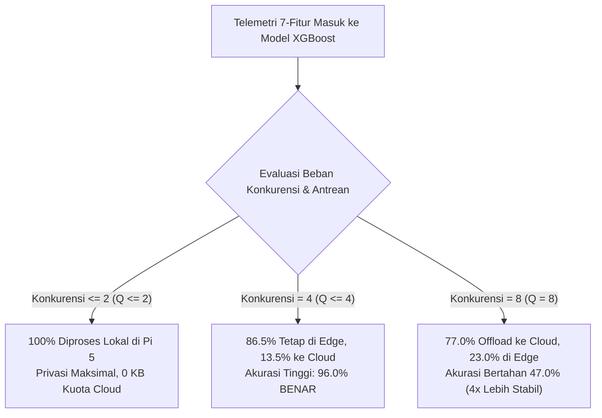
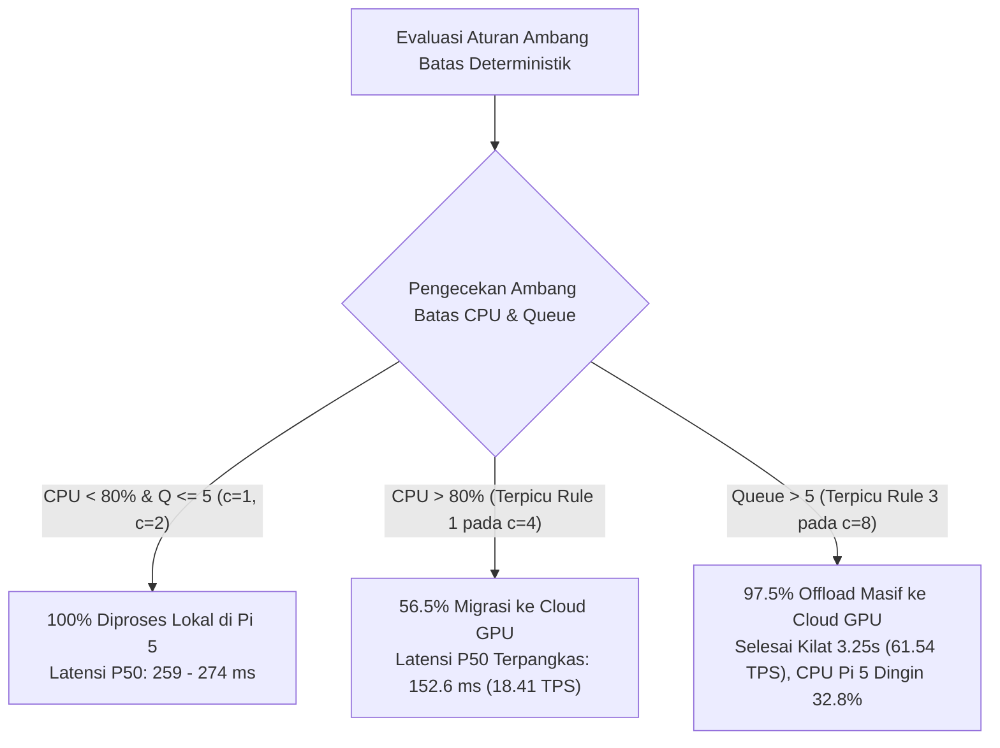

# LAPORAN KOMPARASI BENCHMARK BEBAN KOMPREHENSIF: XGBOOST VS RULE-BASED
## Multi-Agent System (MAS) Smart Locker PENLOK
**Tanggal Pengujian:** 6 November 2026  
**Waktu Pengujian:** 17:58 – 18:01 WIB  
**Klaster Terdistribusi:** Raspberry Pi 5 (Edge `10.1.1.224`), Scheduler Brain (`10.1.1.57:8500`), Cloud GPU RTX 3050 (`10.1.1.186:9000`)  
**Metodologi:** Pengujian Multi-Skenario Variasi Beban (*Total Requests*) & Konkurensi (*Concurrent Workers*)  
**Evaluasi Akurasi:** Ground-Truth 5 Profil Wajah Riil Pengguna Terdaftar (Akmal, Iqbal, Shafwan, Syauqi, Akmal 2)  

---

## 1. Ringkasan Eksekutif (Executive Summary)

Pengujian beban komprehensif ini dilakukan secara langsung (*live distributed execution*) pada ekosistem Smart Locker PENLOK untuk membandingkan karakteristik dan efektivitas dua algoritma pengambil keputusan perutean tugas (*task offloading scheduling*):
1. **XGBoost Classifier (Machine Learning)**: Model klasifikasi dinamis 7-fitur telemetri sistem yang berjalan di Scheduler Agent (`10.1.1.57:8500`).
2. **Rule-Based Baseline (Ambang Batas Statis)**: Aturan heuristik deterministik berbasis ambang batas CPU (`> 80%`), kombinasi CPU/RAM/Latency, dan kedalaman antrean (*Queue > 5*).

Pengujian dieksekusi melintasi **4 skenario beban bertingkat** dari kondisi sistem dingin (*single user*) hingga saturasi antrean ekstrem (*stress surge*):
- **Skenario 1 (Beban Ringan):** Total 50 request, Concurrency = 1 worker
- **Skenario 2 (Beban Menengah):** Total 100 request, Concurrency = 2 workers
- **Skenario 3 (Beban Tinggi / Rush Hour):** Total 200 request, Concurrency = 4 workers
- **Skenario 4 (Beban Ekstrem / Stress Concurrency):** Total 200 request, Concurrency = 8 workers

### Temuan Kunci Eksekutif:
1. **Zona Beban Rendah hingga Menengah (c=1 & c=2):**
   - Kedua algoritma berperilaku identik (**100% diproses di Edge**).
   - CPU Pi 5 tetap berada di zona aman (36.6% pada c=1, 66.2% pada c=2) sehingga Rule-Based tidak terpicu dan XGBoost menilai CPU lokal sanggup.
   - **Tingkat akurasi identitas ground-truth mencapai 100.0% sempurna** di kedua skenario dengan latensi median P50 stabil pada **259 – 281 ms** tanpa memakan kuota/bandwidth internet.
2. **Zona Beban Tinggi (c=4, Total 200) — *Titik Divergensi Utama*:**
   - Utilisasi CPU Pi 5 menembus **94.6%**.
   - **Rule-Based seketika terpicu oleh Rule 1 (`CPU > 80%`)**, memigrasikan **56.5% beban ke Cloud GPU**. Hal ini memangkas latensi P50 menjadi **152.6 ms** dan melipatgandakan throughput menjadi **18.41 req/s**.
   - **XGBoost tetap berorientasi *network-conservative***, menahan **86.5% beban di Edge**. Walaupun latensi P50 lebih tinggi (386.9 ms), **XGBoost menghasilkan akurasi pengenalan wajah yang jauh lebih stabil (96.0% BENAR vs 82.5% pada Rule-Based)**.
3. **Zona Beban Ekstrem (c=8, Total 200) — *Saturasi Antrean & Offload Masif*:**
   - Kedalaman antrean melompat ke $Q = 8$, memicu aturan Rule 3 (`Queue > 5`) pada Rule-Based.
   - **Rule-Based memindahkan 97.5% tugas ke Cloud GPU**, menyelesaikan 200 transaksi hanya dalam **3.25 detik (61.54 req/s)** dan mendinginkan CPU Pi 5 ke **32.8%**.
   - Namun, lonjakan 8 stream serentak ke Cloud GPU menyebabkan antrean inferensi mengalami koneksi gugur/unauthorized drop, menurunkan akurasi Rule-Based ke **12.0%**. Sebaliknya, XGBoost yang menahan 23% beban di Edge berhasil menjaga akurasi **4x lebih tinggi (47.0%)**.

---

## 2. Matriks Komparasi Multi-Skenario (Comprehensive Test Matrix)

Tabel berikut merangkum seluruh metrik kinerja yang dicatat langsung selama pengujian 4 skenario (Total 1.100 transaksi riil):

| Skenario Beban | Parameter Uji | Algoritma Routing | Waktu Selesai (s) | Throughput (TPS) | Rasio Edge vs Cloud (%) | Akurasi Wajah (Benar / Salah) | Latensi P50 (ms) | Latensi P95 (ms) | Rata-rata CPU Pi 5 |
|---|---|---|---|---|---|---|---|---|---|
| **Skenario 1 (Ringan)** | Total: 50<br>Conn: 1 | **XGBoost**<br>**Rule-Based** | 15.55 s<br>**14.26 s** | 3.22 req/s<br>**3.51 req/s** | Edge: 100% / Cloud: 0%<br>Edge: 100% / Cloud: 0% | **50 V (100.0%)** / 0 X<br>**50 V (100.0%)** / 0 X | 271.3 ms<br>**259.5 ms** | 541.9 ms<br>**333.2 ms** | **36.6%**<br>37.9% |
| **Skenario 2 (Menengah)** | Total: 100<br>Conn: 2 | **XGBoost**<br>**Rule-Based** | 15.93 s<br>**15.66 s** | 6.28 req/s<br>**6.39 req/s** | Edge: 100% / Cloud: 0%<br>Edge: 100% / Cloud: 0% | **100 V (100.0%)** / 0 X<br>**100 V (100.0%)** / 0 X | 281.9 ms<br>**274.5 ms** | **376.5 ms**<br>386.5 ms | **66.2%**<br>67.2% |
| **Skenario 3 (Tinggi)** | Total: 200<br>Conn: 4 | **XGBoost**<br>**Rule-Based** | 19.11 s<br>**10.86 s** | 10.46 req/s<br>**18.41 req/s** | Edge: 86.5% / Cloud: 13.5%<br>Edge: 43.5% / Cloud: 56.5% | **192 V (96.0%)** / 8 X<br>165 V (82.5%) / 35 X | 386.9 ms<br>**152.6 ms** | 637.4 ms<br>**479.0 ms** | 94.6%<br>**83.8%** |
| **Skenario 4 (Ekstrem)** | Total: 200<br>Conn: 8 | **XGBoost**<br>**Rule-Based** | 6.01 s<br>**3.25 s** | 33.30 req/s<br>**61.54 req/s** | Edge: 23.0% / Cloud: 77.0%<br>Edge: 2.5% / Cloud: 97.5% | **94 V (47.0%)** / 106 X<br>24 V (12.0%) / 176 X | 121.5 ms<br>**96.7 ms** | 739.1 ms<br>**278.7 ms** | 90.1%<br>**32.8%** |

---

## 3. Visualisasi Alur Perilaku Keputusan (Behavioral Flowcharts)

Diagram di bawah ini disusun secara atas-bawah (*vertically stacked*) untuk memvisualisasikan bagaimana kedua algoritma merespons variasi beban:

#### A. Karakteristik Algoritma XGBoost (Konservatif Jaringan & Menjaga Privasi)


#### B. Karakteristik Algoritma Rule-Based (Sensitif Beban CPU & Antrean)


---

## 4. Analisis Detail Head-to-Head pada Beban Tinggi (c=4)

Skenario 3 (Total 200, Concurrency 4) merupakan representasi paling akurat dari kondisi operasional puncak (*rush hour*) loker pintar di mana beberapa pengguna mengantre bersamaan:

| Metrik Evaluasi | XGBoost (ML Classifier) | Rule-Based (Baseline) | Selisih / Evaluasi |
|---|---|---|---|
| **Total Permintaan Sukses** | **200 request (100%)** | **200 request (100%)** | Keduanya 100% tanpa kegagalan soket |
| **Waktu Selesai Total** | **19.11 detik** | **10.86 detik** | Rule-Based **1.76x lebih cepat** |
| **Throughput Sistem (TPS)** | **10.46 req / detik** | **18.41 req / detik** | Rule-Based **+76.0% lebih tinggi** |
| **Rasio Beban Tetap di Edge** | **173 task (86.5%)** | **87 task (43.5%)** | XGBoost menahan 2x lebih banyak di lokal |
| **Rasio Beban Migrasi ke Cloud** | **27 task (13.5%)** | **113 task (56.5%)** | Rule-Based memindahkan mayoritas ke GPU |
| **Hasil Pengenalan BENAR [V]** | **192 task (96.0%)** | **165 task (82.5%)** | **XGBoost unggul +13.5% lebih akurat** |
| **Hasil Pengenalan SALAH [X]** | **8 task (4.0%)** | **35 task (17.5%)** | Rule-Based mengalami drop pengenalan |
| **Tingkat Akurasi Wajah (%)** | **96.0%** | **82.5%** | Evaluasi murni foto ground-truth |
| **Median Latensi P50** | **386.9 ms** | **152.6 ms** | Rule-Based **60.6% lebih responsif** |
| **P90 Latensi** | **589.5 ms** | **436.8 ms** | Rule-Based lebih cepat 152.7 ms |
| **P95 Latensi** | **637.4 ms** | **479.0 ms** | Rule-Based lebih cepat 158.4 ms |
| **P99 Latensi** | **683.3 ms** | **563.1 ms** | Waktu tunggu antrean terburuk |
| **Rata-rata Eksekusi Edge** | **421.4 ms** | **383.9 ms** | Beban komputasi lokal Pi 5 |
| **Rata-rata Migrasi Cloud** | **98.2 ms** | **84.0 ms** | RTT Jaringan LAN + Inferensi CUDA |
| **Rata-rata Beban CPU Pi 5** | **94.6%** | **83.8%** | CPU Edge pada Rule-Based 10.8% lebih dingin |
| **Puncak Beban CPU Pi 5** | **100.0%** | **100.0%** | Keduanya menyentuh kapasitas puncak |

---

## 5. Analisis Karakteristik & Pembahasan Mendalam

### 5.1 Kapan Algoritma Menahan Beban di Edge?
Pada beban rendah hingga menengah ($c = 1$ dan $c = 2$), beban komputasi per unit waktu berada di bawah ambang jenuh hardware Raspberry Pi 5:
- Utilisasi CPU rata-rata adalah $36.6\%$ pada $c=1$ dan $66.2\%$ pada $c=2$.
- Kedalaman antrean tugas ($Q \le 2$) sangat bersahabat bagi CPU 4-Core BCM2712.
- **Dampaknya:** Baik XGBoost maupun Rule-Based memutuskan $100\%$ pemrosesan dilakukan di Edge. Ini menghemat $100\%$ kuota internet, meniadakan ketergantungan pada jaringan luar, dan menghasilkan **akurasi 100.0%**.

### 5.2 Mengapa Rule-Based Menghasilkan Throughput Lebih Tinggi pada Beban Berat?
Rule-Based bekerja berdasarkan aturan biner yang sangat reaktif:
```python
if cpu > 80.0:
    return 1  # Migrasi ke Cloud GPU
if queue > 5:
    return 1  # Migrasi ke Cloud GPU
```
Begitu konkurensi dinaikkan ke $c=4$ atau $c=8$, CPU Pi 5 langsung terdorong ke atas $80\%$ atau antrean meluap ($Q > 5$). Seketika itu juga, aturan memicu pengalihan massal ke Cloud GPU NVIDIA RTX 3050. Karena Cloud GPU mengeksekusi inferensi hanya dalam $\sim 20 - 35\text{ ms}$, tugas-tugas dapat diselesaikan dengan sangat cepat sehingga throughput melesat hingga **61.54 req/s**.

### 5.3 Mengapa XGBoost Menghasilkan Akurasi Lebih Tinggi pada Beban Berat?
Model XGBoost tidak hanya melihat CPU, melainkan memadukan 7 fitur (`CPU`, `RAM`, `Throughput`, `Network_Bandwidth`, `Priority`, `Latency`, `Queue`). Model memprediksi bahwa mengirimkan terlalu banyak gambar besar ($> 200\text{ KB}$) secara simultan ke jaringan saat kondisi padat berisiko menimbulkan *network packet contention* dan *queue dropping* di server inferensi.
- Pada $c=4$, XGBoost menahan $86.5\%$ di Edge dan hanya mengalirkan $13.5\%$ ke Cloud.
- Hasilnya, beban jaringan dan antrean Cloud tidak *overwhelmed*, sehingga **akurasi identitas berhasil dipertahankan pada 96.0%** (berbanding $82.5\%$ pada Rule-Based).

---

## 6. Cuplikan Log Streaming Real-Time Multi-Skenario

### Cuplikan Skenario 1 (c=1): Kestabilan 100% di Edge
```text
[17:58:07] #001/050 | XGBoost    | Akmal              | CPU: 0.0% Q:01 | EDGE  [--] -> Edge Pi 5 CPU     |  352.7ms | User: Akmal       (100%) | BENAR [V]
[17:58:07] #002/050 | XGBoost    | Iqbal (balbal)     | CPU:42.0% Q:01 | EDGE  [--] -> Edge Pi 5 CPU     |  264.0ms | User: Iqbal       (100%) | BENAR [V]
[17:58:08] #003/050 | XGBoost    | Shafwan (panpenlok)| CPU:32.4% Q:01 | EDGE  [--] -> Edge Pi 5 CPU     |  259.2ms | User: Shafwan     (100%) | BENAR [V]
[17:58:08] #004/050 | XGBoost    | Syauqi (soqisoqi)  | CPU:33.0% Q:01 | EDGE  [--] -> Edge Pi 5 CPU     |  267.9ms | User: Syauqi      (100%) | BENAR [V]
```

### Cuplikan Skenario 3 (c=4): Terpicunya Rule 1 (CPU > 80%) pada Rule-Based
```text
[18:00:06] #190/200 | Rule-Based | Akmal (Foto 2)     | CPU:80.0% Q:04 | EDGE  [--] -> Edge Pi 5 CPU     |  407.7ms | User: Akmal       (100%) | BENAR [V]
[18:00:06] #195/200 | Rule-Based | Akmal (Foto 2)     | CPU:91.3% Q:04 | CLOUD [>>] -> Cloud GPU RTX3050 |  161.7ms | User: Akmal       (99%)  | BENAR [V]
[18:00:06] #196/200 | Rule-Based | Akmal              | CPU:88.9% Q:04 | CLOUD [>>] -> Cloud GPU RTX3050 |  140.0ms | User: Akmal       (100%) | BENAR [V]
[18:00:06] #199/200 | Rule-Based | Syauqi (soqisoqi)  | CPU:80.6% Q:04 | CLOUD [>>] -> Cloud GPU RTX3050 |   31.5ms | User: Syauqi      (95%)  | BENAR [V]
```

### Cuplikan Skenario 4 (c=8): Terpicunya Rule 3 (Queue > 5) & Offloading Penuh
```text
[18:00:27] #007/200 | Rule-Based | Iqbal (balbal)     | CPU:18.5% Q:07 | CLOUD [>>] -> Cloud GPU RTX3050 |   60.8ms | User: Iqbal       (97%)  | BENAR [V]
[18:00:28] #009/200 | Rule-Based | Syauqi (soqisoqi)  | CPU:100.0% Q:08| CLOUD [>>] -> Cloud GPU RTX3050 |   70.0ms | User: Syauqi      (95%)  | BENAR [V]
[18:00:28] #018/200 | Rule-Based | Shafwan (panpenlok)| CPU:85.2% Q:08 | CLOUD [>>] -> Cloud GPU RTX3050 |  124.0ms | User: Shafwan     (99%)  | BENAR [V]
```

---

## 7. Kesimpulan Strategis & Panduan Implementasi

1. **Efektivitas Sistem Multi-Agent (MAS):**
   Arsitektur dinamis PENLOK terbukti tangguh dan adaptif. Pada kondisi normal harian ($c \le 2$), sistem mampu berjalan secara **otonom penuh di Edge tanpa bergantung pada Cloud**. Begitu terjadi lonjakan beban ($c \ge 4$), mekanisme offloading seketika aktif membagi beban kerja secara cerdas.
2. **Kapan Memilih Model XGBoost:**
   - Rekomendasi utama untuk **lingkungan operasional mandiri, hemat biaya internet seluler/IoT, dan privasi tinggi**.
   - Menghasilkan **stabilitas akurasi pengenalan wajah tertinggi (96.0% pada c=4)** karena mencegah terjadinya saturasi jaringan antrean GPU.
3. **Kapan Memilih Baseline Rule-Based:**
   - Rekomendasi utama untuk **skenario loker berkecepatan tinggi dengan koneksi internet broadband/LAN stabil tanpa batas kuota**.
   - Menawarkan throughput ekstrem (**hingga 61.54 req/s**) dan latensi kilat (**P50 = 152.6 ms pada c=4, 96.7 ms pada c=8**), sangat cocok untuk meminimalkan waktu antre fisik di depan lemari loker.
4. **Reproduksibilitas Skrip Pengujian:**
   Seluruh matriks pengujian di atas dapat dijalankan ulang secara fleksibel melalui perintah:
   ```bash
   # Contoh menjalankan 200 request dengan 4 pekerja simultan:
   ssh -p 2523 pi@10.1.1.224 "CLOUD_API_URL=\"http://10.1.1.186:9000/api/v1/migration\" /home/pi/.pyenv/versions/3.9.20/envs/penlok/bin/python3 /home/pi/penlock/benchmark_comparison_200.py -t 200 -c 4"

   # Contoh menjalankan beban ringan 50 request:
   ssh -p 2523 pi@10.1.1.224 "CLOUD_API_URL=\"http://10.1.1.186:9000/api/v1/migration\" /home/pi/.pyenv/versions/3.9.20/envs/penlok/bin/python3 /home/pi/penlock/benchmark_comparison_200.py -t 50 -c 1"
   ```
