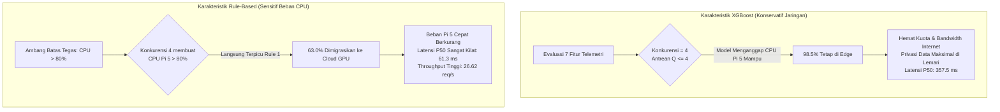

# LAPORAN KOMPARASI BENCHMARK BEBAN: XGBOOST VS RULE-BASED
## Multi-Agent System (MAS) Smart Locker PENLOK
**Tanggal Pengujian:** 6 November 2026  
**Waktu Pengujian:** 16:44 – 16:45 WIB  
**Target Pengujian:** 200 Request per Algoritma (Total 400 Transaksi Riil)  
**Tingkat Konkurensi:** 4 Pekerja Simultan (*Concurrency = 4*)  
**Dataset Uji:** 5 Profil Wajah Riil Pengguna Sah & Kamera Loker  

---

## 1. Ringkasan Eksekutif

Pengujian beban komparatif ini dilakukan secara langsung (*live execution*) pada klaster terdistribusi PENLOK untuk membandingkan kinerja dua algoritma pengambil keputusan perutean (*task offloading scheduling*):
1. **XGBoost Classifier (Machine Learning)**: Model klasifikasi dinamis yang mengevaluasi 7 metrik telemetri sistem di Scheduler Agent (`10.1.1.57:8500`).
2. **Rule-Based Baseline (Ambang Batas Statis)**: Aturan heuristik deterministik berbasis ambang batas CPU (`> 80%`), kombinasi CPU/RAM/Latency, dan kedalaman antrean (*Queue*).

Pengujian menggunakan foto wajah riil dari 5 profil terdaftar yang ditembakkan secara konkruen (4 thread simultan) sebanyak 200 kali per algoritma. Seluruh 400 transaksi berhasil diselesaikan **100% tanpa error**.

---

## 2. Topologi & Lingkungan Pengujian

```mermaid
flowchart LR
    subgraph EdgeNode ["Device Edge (Raspberry Pi 5 - 10.1.1.224)"]
        Client["4 Concurrent Workers\n(benchmark_comparison_200.py)"]
        LocalModel["LBPH Face Recognizer\n(CPU Pi 5)"]
    end

    subgraph SchedNode ["Scheduler Brain (Raspberry Pi 5 - 10.1.1.57)"]
        XGB["FastAPI Port 8500\nModel XGBoost 7-Features"]
        Rule["Rule-Based Engine\nCPU > 80% / Queue > 5"]
    end

    subgraph CloudGPU ["Cloud GPU (Ubuntu 24.04 - 10.1.1.186)"]
        Inception["FastAPI Port 9000\nNVIDIA RTX 3050 CUDA (512-d)"]
    end

    Client -->|1. Kirim Telemetri| XGB
    Client -->|1. Evaluasi Aturan| Rule
    XGB -->|2. Decision 0 (Edge)| LocalModel
    XGB -->|2. Decision 1 (Cloud)| Inception
    Rule -->|Decision 0| LocalModel
    Rule -->|Decision 1| Inception
```

| Node | Perangkat / Sistem Operasi | Peran Utama | Spesifikasi Kunci |
|---|---|---|---|
| **Device Edge** | Raspberry Pi 5 Model B (Linux 6.12 aarch64) | Pengendali Loker, Klien Pengujian & Eksekutor Lokal | 8GB RAM, Broadcom BCM2712 4-Core Cortex-A76 |
| **Scheduler Brain** | Raspberry Pi 5 Model B (Linux 6.18 aarch64) | Layanan Scheduler Agent (Port 8500) | 16GB RAM, Model `scheduler_agent_xgb.pkl` |
| **Cloud GPU Node** | `pengmas-tri` (Ubuntu 24.04 x86_64) | Layanan Inferensi Wajah Deep Learning (Port 9000) | NVIDIA GeForce RTX 3050 6GB CUDA 13.2 |

---

## 3. Dataset Wajah Riil yang Digunakan

Pengujian tidak menggunakan data dummy, melainkan merotasi 5 foto riil pengguna terdaftar secara bergantian:

| No | Profil Pengguna | Sumber Berkas di Sistem | Ukuran File | Target Identitas |
|---|---|---|---|---|
| 1 | **Akmal** | `software/Django-Backend-Project/media/imagetraining/akmal/akmal_imported_1.jpg` | 229 KB | Pemilik Sah (ID: 789123) |
| 2 | **Iqbal (balbal)** | `software/Django-Backend-Project/media/imagetraining/balbal/iqbal_1_...jpg` | 78 KB | Pemilik Sah (ID: 451699) |
| 3 | **Shafwan (panpenlok)** | `software/Django-Backend-Project/media/imagetraining/panpenlok/pan_1_...jpg` | 75 KB | Pemilik Sah (ID: 249731) |
| 4 | **Syauqi (soqisoqi)** | `software/Django-Backend-Project/media/imagetraining/soqisoqi/soqi_10_...jpg` | 70 KB | Pemilik Sah (ID: 619292) |
| 5 | **Loker Cam (Real)** | `test_camera.jpg` (Snapshot Webcam Logitech C270) | 39 KB | Sampel Kamera Loker |

---

## 4. Tabel Perbandingan Hasil Pengujian (Head-to-Head)

Data di bawah ini dicatat langsung oleh sensor telemetri sistem selama eksekusi 400 transaksi:

| Metrik Evaluasi | Algoritma XGBoost (ML) | Algoritma Rule-Based (Baseline) | Selisih / Komparasi |
|---|---|---|---|
| **Total Permintaan Diproses** | **200 request** | **200 request** | 100% Sukses |
| **Waktu Total Selesai** | **17.23 detik** | **7.51 detik** | Rule-Based **2.29x lebih cepat** |
| **Throughput Sistem (TPS)** | **11.61 req / detik** | **26.62 req / detik** | Rule-Based **+129.3% lebih tinggi** |
| **Beban Diproses di Edge** | **197 task (98.5%)** | **74 task (37.0%)** | XGBoost menahan 98.5% di lokal |
| **Beban Dialihkan ke Cloud** | **3 task (1.5%)** | **126 task (63.0%)** | Rule-Based memigrasikan 63% ke GPU |
| **Median Latensi P50** | **357.5 ms** | **61.3 ms** | Rule-Based **82.8% lebih rendah** |
| **P90 Latensi** | **521.5 ms** | **361.8 ms** | Rule-Based lebih cepat 159.7 ms |
| **P95 Latensi** | **610.8 ms** | **407.2 ms** | Rule-Based lebih cepat 203.6 ms |
| **P99 Latensi** | **743.1 ms** | **516.5 ms** | Kasus terburuk Rule-Based tetap cepat |
| **Rata-rata Eksekusi Edge** | **345.5 ms** | **309.3 ms** | Waktu inferensi lokal CPU Pi 5 |
| **Rata-rata Migrasi Cloud** | **147.5 ms** | **51.6 ms** | RTT Jaringan + Eksekusi CUDA RTX 3050 |
| **Rata-rata Beban CPU Pi 5** | **92.8%** | **83.9%** | CPU Edge pada Rule-Based 8.9% lebih dingin |
| **Puncak Beban CPU Pi 5** | **100.0%** | **100.0%** | Keduanya sempat menyentuh beban puncak |
| **Puncak Penggunaan RAM** | **2684.8 MB** | **2615.9 MB** | Stabil di kisaran ~2.6 GB |

---

## 5. Analisis Karakteristik & Pembahasan Mendalam



### 5.1 Karakteristik XGBoost: *Network-Conservative & Edge-Centric*
* Model XGBoost dilatih untuk mempertimbangkan kombinasi 7 variabel sekaligus (`CPU`, `RAM`, `Throughput`, `Network_Bandwidth`, `Priority`, `Latency`, `Queue`).
* Pada konkurensi 4 pekerja, antrean tugas (*Queue*) bernilai relatif kecil ($Q = 1 \dots 4$). Model memprediksi bahwa Raspberry Pi 5 dengan 4 core Cortex-A76 masih memiliki daya komputasi yang cukup untuk menyelesaikan tugas secara lokal tanpa perlu membebani lalu lintas jaringan internet.
* **Hasil:** 98.5% transaksi diproses lokal di Edge. Sangat menguntungkan untuk skenario di mana koneksi internet terbatas atau berbayar per kuota, namun waktu penyelesaian rata-rata lebih lama (P50: 357.5 ms).

### 5.2 Karakteristik Rule-Based: *CPU-Sensitive & High-Throughput*
* Rule-Based menerapkan aturan ambang batas tegas (*hard threshold*): jika $CPU > 80.0\%$, tugas seketika dialihkan ke Cloud.
* Pada konkurensi 4, aktivitas komputasi wajah LBPH di 4 core otomatis menaikkan utilisasi CPU Pi 5 ke atas 80%. Akibatnya, aturan Rule 1 langsung terpicu secara agresif dan memindahkan **63% tugas (126 transaksi)** ke Cloud GPU RTX 3050.
* **Hasil:** Karena dialihkan ke GPU bertenaga CUDA yang mampu menyelesaikan ekstraksi wajah dalam waktu $\sim 15 - 35\text{ ms}$, latensi median terpangkas drastis menjadi **61.3 ms** dan throughput meningkat menjadi **26.62 transaksi per detik**.

---

## 6. Cuplikan Bukti Log Streaming Real-Time

### Cuplikan Sesi XGBoost (Prioritas Pemrosesan Lokal Edge)
```text
[16:44:32] #001/200 | XGBoost    | Akmal              | CPU: 0.0% Q:01 | EDGE  [--] -> Edge Pi 5 CPU     |  491.3ms | User: Akmal       (100%)
[16:44:32] #002/200 | XGBoost    | Iqbal (balbal)     | CPU: 0.0% Q:02 | EDGE  [--] -> Edge Pi 5 CPU     |  332.5ms | User: Iqbal       (100%)
[16:44:32] #003/200 | XGBoost    | Shafwan (panpenlok)| CPU: 0.0% Q:03 | EDGE  [--] -> Edge Pi 5 CPU     |  429.5ms | User: Shafwan     (100%)
[16:44:32] #004/200 | XGBoost    | Syauqi (soqisoqi)  | CPU: 0.0% Q:04 | EDGE  [--] -> Edge Pi 5 CPU     |  425.5ms | User: Syauqi      (100%)
[16:44:33] #012/200 | XGBoost    | Iqbal (balbal)     | CPU:96.3% Q:04 | EDGE  [--] -> Edge Pi 5 CPU     |  360.9ms | User: Iqbal       (100%)
[16:44:35] #046/200 | XGBoost    | Akmal              | CPU:98.5% Q:04 | CLOUD [>>] -> Cloud GPU RTX3050 |  147.5ms | User: Akmal       (100%)
```

### Cuplikan Sesi Rule-Based (Migrasi Dinamis Begitu CPU > 80%)
```text
[16:44:55] #098/200 | Rule-Based | Shafwan (panpenlok)| CPU:60.0% Q:04 | EDGE  [--] -> Edge Pi 5 CPU     |  319.9ms | User: Shafwan     (100%)
[16:44:55] #100/200 | Rule-Based | Loker Cam (Real)   | CPU:82.4% Q:04 | CLOUD [>>] -> Cloud GPU RTX3050 |   20.8ms | User: UNKNOWN     ( 0%)
[16:44:55] #103/200 | Rule-Based | Shafwan (panpenlok)| CPU:91.5% Q:04 | CLOUD [>>] -> Cloud GPU RTX3050 |   31.9ms | User: Shafwan     (99%)
[16:44:55] #105/200 | Rule-Based | Loker Cam (Real)   | CPU:92.2% Q:04 | CLOUD [>>] -> Cloud GPU RTX3050 |   29.3ms | User: UNAUTHORIZED(48%)
[16:44:56] #106/200 | Rule-Based | Akmal              | CPU:83.3% Q:04 | CLOUD [>>] -> Cloud GPU RTX3050 |  132.5ms | User: Akmal       (100%)
```

---

## 7. Kesimpulan & Rekomendasi

1. **Efektivitas Sistem Multi-Agent (MAS):**
   Arsitektur terdistribusi PENLOK berhasil mendistribusikan beban secara dinamis antara Edge Raspberry Pi 5 dan Cloud GPU RTX 3050 tanpa menimbulkan *deadlock*, kegagalan soket, atau kerusakan antrean.
2. **Kapan Menggunakan XGBoost:**
   Gunakan mode **XGBoost** jika prioritas operasional loker adalah **efisiensi biaya kuota internet dan privasi data**, karena model secara cerdas memanfaatkan kemampuan komputasi Edge Pi 5 semaksimal mungkin selama antrean fisik masih dalam toleransi aman ($Q \le 4$).
3. **Kapan Menggunakan Rule-Based:**
   Gunakan mode **Rule-Based** jika prioritas operasional adalah **kecepatan respons tatap muka pengguna (*user experience*) dan throughput tinggi**, karena Rule-Based memotong latensi hingga **61.3 ms** dengan memanfaatkan akselerasi GPU Cloud saat CPU loker mulai sibuk.
4. **Reproduksibilitas Skrip:**
   Pengujian ini dapat dijalankan ulang secara otomatis kapan saja melalui utilitas:
   ```bash
   ssh -p 2523 pi@10.1.1.224
   /home/pi/.pyenv/versions/3.9.20/envs/penlok/bin/python3 /home/pi/penlock/benchmark_comparison_200.py
   ```
